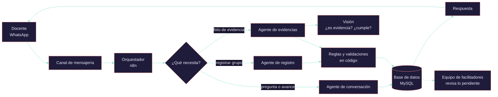

  
  
  
  
  
  
  
  
  

# Asistente educativo con IA

Un asistente por **WhatsApp** que acompaña a docentes de primaria, secundaria y bachillerato que enseñan programación en sus salones, dentro de un programa de **Fundación Televisa**. El docente le escribe como le escribiría a una persona: da de alta sus grupos, manda las fotos de las actividades que hizo con sus alumnos y pregunta cómo va. El asistente entiende lo que necesita, revisa las fotos con visión por computadora, guarda todo en la base de datos y le contesta en segundos.

Lo diseñé y lo construyo yo, de punta a punta, como parte de mi trabajo de **Data & AI Analyst**.

> 🔒 El código, los prompts y los datos son privados. Aquí solo describo qué hace y cómo está pensado. Todos los ejemplos usan datos ficticios.

  

## Qué hace

| | |
|---|---|
| 💬 **Conversa en lenguaje natural** | Sin menús, opciones numeradas ni palabras clave. Entiende mensajes informales, con errores o varios mensajes seguidos. |
| 🏫 **Registra escuelas y grupos** | Guía al docente para dar de alta sus grupos, valida los datos y evita duplicados. |
| 📸 **Revisa fotos de evidencia** | Un modelo de visión confirma que la foto es una actividad escolar real y la compara con el criterio de la lección. Si cumple la valida; si tiene dudas, la manda a revisión humana. |
| 📈 **Le cuenta su avance** | Cuántas lecciones lleva en cada grupo y qué le falta para su siguiente meta. |
| 🔔 **Le escribe primero** | Mensajes proactivos según el calendario del ciclo escolar, distintos según el avance de cada docente, sin repetirse. |
| 🧑‍🏫 **Trabaja con el equipo humano** | Lo que el asistente no puede decidir solo pasa a los facilitadores del programa, que lo revisan en una app interna. |

## Cómo fluye un mensaje

## Cómo está construido

- **Orquestación en n8n.** Un flujo de punta a punta recibe cada mensaje, recupera el contexto de la conversación, decide qué necesita el docente y lo manda al agente indicado.
- **Agentes especializados con LLM.** Cada uno tiene un trabajo acotado: registrar, recolectar los datos de una foto o conversar y consultar el avance. Usan herramientas para leer la base de datos en lugar de suponer.
- **Visión por computadora.** Revisa cada foto en dos pasos: primero si es evidencia escolar y después si cumple el criterio de la lección que dijo el docente.
- **IA + código.** El modelo conversa y entiende, pero lo que se guarda pasa por validaciones deterministas: catálogo cerrado de lecciones, detección de duplicados y que el grupo exista entre los del docente.
- **Mensajes proactivos.** Un flujo diario calcula qué mensaje le toca a cada docente según el calendario y su avance, elige uno solo por persona y registra lo enviado para no repetir.
- **Medición.** Un tablero de métricas para el equipo: uso, lecciones registradas, cómo llegan las evidencias y los errores por tipo, con revisión de sus causas.

## Decisiones de diseño (lo que he aprendido)

1. **Conversación, no menús.** Un docente con 40 alumnos no va a aprender comandos. El asistente se adapta a cómo escribe la gente, no al revés.
2. **El modelo nunca adivina un dato que importa.** El número de lección siempre lo dice el docente. Si su respuesta es ambigua ("otra actividad"), el asistente pregunta una vez y de forma natural, en lugar de suponer.
3. **Lo que se guarda lo decide el código.** El modelo propone y el código valida. Así un error de redacción del modelo nunca termina como un dato incorrecto en la base.
4. **Detectar cuando la plática se atora.** Si el asistente está por repetir la misma pregunta, cambia de estrategia y explica qué le falta, en vez de dar vueltas.
5. **Humanos donde hace falta.** La IA valida lo que puede validar con seguridad y el resto pasa a revisión de una persona. Mejor eso que aprobar todo o rechazar todo.
6. **Medir para mejorar.** Cada error se clasifica y se revisa su causa; muchas mejoras del asistente salieron de leer esas conversaciones.

## Mi rol

Diseño de la conversación y de los prompts, arquitectura de los flujos en n8n, integración con WhatsApp, visión por computadora, modelo de datos en MySQL, mensajes proactivos, tablero de métricas y mejora continua a partir de las conversaciones reales.

## Sobre este repositorio

Este repositorio es una **vitrina del proyecto**. El código, los prompts, las credenciales y los datos de docentes son privados y no se publican. Las imágenes y conversaciones de este README son ilustrativas y usan datos inventados.

